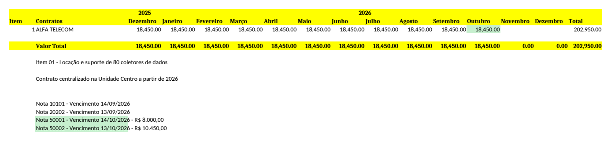

# 📄 Leitor Automático de Notas Fiscais e Boletos

[](https://github.com/Kerchak26/leitor-notas-fiscais/actions/workflows/testes.yml)


Automação em Python para o **contas a pagar**: lê os e-mails com notas fiscais e boletos,
extrai os dados dos PDFs anexados e lança cada nota na **planilha de controle de custos**
da unidade certa, no contrato e no mês certos.

> Projeto nascido de uma rotina real de trabalho (conferência e lançamento manual de notas
> fiscais em planilhas de custos) e desenvolvido também como projeto acadêmico.
> **Todos os dados deste repositório são fictícios.**

---

## Sumário

- [O problema](#o-problema)
- [O que o projeto faz](#o-que-o-projeto-faz)
- [Demonstração rápida](#demonstração-rápida)
- [Instalação](#instalação)
- [Uso no dia a dia](#uso-no-dia-a-dia)
- [Lançamento nas capas de custos](#lançamento-nas-capas-de-custos)
- [Arquitetura](#arquitetura)
- [Testes](#testes)
- [Limitações e próximos passos](#limitações-e-próximos-passos)
- [Equipe](#equipe)

---

## O problema

O gestor recebe dos fornecedores e-mails com a **nota fiscal** e o **boleto** em PDF e os
encaminha para o setor financeiro. Para cada e-mail, alguém precisa:

1. abrir os PDFs e copiar número da nota, fornecedor, valor e vencimento do boleto;
2. descobrir a qual **unidade** da empresa a nota pertence;
3. abrir a planilha de custos ("capa") daquela unidade, achar a **aba do fornecedor** e
   a **coluna do mês**, e lançar o valor. Se o contrato teve duas notas no mês, somar;
4. anotar "Nota X - Vencimento dd/mm/aaaa" na planilha para controle.

É um trabalho repetitivo, demorado e sujeito a erros de digitação. Este projeto
automatiza o processo inteiro e deixa para a pessoa só a **conferência**.

## O que o projeto faz

| Etapa | Como |
|---|---|
| 📬 **Lê os e-mails** | IMAP (Gmail, Outlook…), filtrando por remetente, assunto e data. Encontra PDFs inclusive em e-mails **encaminhados como anexo** (`.eml`) |
| 🗂️ **Separa nota e boleto** | Classifica **cada página** do PDF: nota e boleto podem vir em arquivos separados ou no mesmo PDF |
| 🧾 **Lê a nota fiscal** | DANFE (NF-e) e NFS-e: número, série, emitente, CNPJ, emissão, valor total, destinatário |
| 💳 **Lê o boleto** | Vencimento e valor decodificados da **linha digitável**, validada pelos dígitos verificadores |
| 🔗 **Associa boleto ↔ nota** | Por CNPJ, número do documento, valor e vencimento da duplicata. Trata **parcelas** e **várias notas no mesmo e-mail** |
| 📊 **Gera uma planilha** | Excel/CSV com todas as notas e boletos, sem duplicar registros |
| 🏢 **Lança nas capas de custos** | Identifica unidade, aba do fornecedor, contrato e mês, e lança o valor numa **cópia para conferência** |

### Resultado na capa de custos

Duas notas do mesmo contrato com vencimento em outubro: o valor do mês vira a soma das
duas (`=8000+10450`), a célula fica verde, ganha um comentário com as notas, e as
anotações são escritas embaixo, no formato que a equipe já usava.



## Demonstração rápida

Não precisa de e-mail nem de dados reais. Os exemplos são gerados na hora:

```bash
git clone https://github.com/Kerchak26/leitor-notas-fiscais.git
cd leitor-notas-fiscais
python -m venv .venv && source .venv/bin/activate   # Windows: .venv\Scripts\activate
pip install -r requirements.txt

python tests/gerar_exemplos.py                                 # notas, boletos e capas fictícias
python -m nf_reader pasta dados/exemplos --capas capas.toml.example
```

Saída:

```
       Número NF  Emissão         Valor NF  Vencimento        Boleto  Emitente
----------------------------------------------------------------------------------------------------
            4587  14/10/2026      3.250,90  13/11/2026      3.250,90  DISTRIBUIDORA ALFA COMERCIO LTDA
           50001  14/10/2026      8.000,00  14/10/2026      8.000,00  ALFA TELECOM COMERCIO E SERVICOS LT
           50002  14/10/2026     10.450,00  13/10/2026     10.450,00  ALFA TELECOM COMERCIO E SERVICOS LT
2026000123 (1/2)  03/10/2026     12.544,00  03/11/2026      6.272,00  TECH SOLUCOES EM SOFTWARE EIRELI
2026000123 (2/2)  03/10/2026     12.544,00  03/12/2026      6.272,00  TECH SOLUCOES EM SOFTWARE EIRELI

5 lançamento(s) novo(s) gravado(s) em dados/notas_fiscais.xlsx

Capas: 2 lançamento(s) na cópia para conferência, 3 pendente(s)
  ✔ Centro / Alfa Telecom / M3: Nota 50001 R$ 8.000,00
  ✔ Centro / Alfa Telecom / M3: Nota 50002 R$ 10.450,00
  ⚠ Nota 2026000123 (TECH SOLUCOES EM SOFTWARE EIRE): unidade não identificada; cadastre o CNPJ/endereço ou crie uma regra
  ⚠ Nota 2026000123 (TECH SOLUCOES EM SOFTWARE EIRE): unidade não identificada; cadastre o CNPJ/endereço ou crie uma regra
  ⚠ Nota 4587 (DISTRIBUIDORA ALFA COMERCIO LT): nenhuma aba com o nome do fornecedor 'DISTRIBUIDORA ALFA COMERCIO LTDA'; crie uma regra com a aba
```

As pendências são de propósito: elas mostram que o programa **não lança nada no chute**.
O que ele não consegue identificar com segurança vai para um relatório, com o motivo.

## Instalação

Requisitos: **Python 3.11+**.

```bash
pip install -r requirements.txt
cp .env.example .env                    # dados do e-mail
cp capas.toml.example capas.toml        # unidades, capas e regras (opcional)
```

### Configurando o e-mail (`.env`)

| Variável | Para quê |
|---|---|
| `IMAP_HOST`, `IMAP_PORT` | Servidor IMAP (`imap.gmail.com`, `outlook.office365.com`…) |
| `EMAIL_USUARIO`, `EMAIL_SENHA` | Conta. No Gmail use uma **senha de app**, nunca a senha normal |
| `FILTRO_REMETENTE` | Só lê e-mails destes remetentes (ex.: o gestor que encaminha as notas) |
| `FILTRO_ASSUNTO` | Só lê e-mails com estas palavras no assunto (opcional) |
| `DATA_INICIO` | Ignora e-mails anteriores a esta data |
| `MARCAR_COMO_LIDO` | Por padrão o programa **não** altera a caixa de entrada |

**Gmail:** ative a verificação em duas etapas e gere uma senha de app em
<https://myaccount.google.com/apppasswords>.

> 🔒 `.env` e `capas.toml` estão no `.gitignore`: senhas, CNPJs, endereços e caminhos
> reais nunca vão para o repositório.

## Uso no dia a dia

```bash
python -m nf_reader email                 # lê os e-mails → dados/notas_fiscais.xlsx
python -m nf_reader email --capas         # ... e também lança nas capas de custos
python -m nf_reader pasta caminho/pdfs    # processa PDFs já salvos (cada subpasta = um e-mail)
python -m nf_reader capas                 # refaz as capas sem ler e-mail (após criar uma regra)
python -m nf_reader pasta pdfs -o notas.csv   # saída em CSV (abre direto no Excel pt-BR)
```

Para rodar sozinho, agende o comando:
- **Windows:** Agendador de Tarefas → `.venv\Scripts\python.exe -m nf_reader email --capas`,
  com "Iniciar em" apontando para a pasta do projeto.
- **Linux/macOS:** `0 * * * * cd /caminho/projeto && .venv/bin/python -m nf_reader email --capas`

### Colunas da planilha gerada

Número NF · Série · Emitente · CNPJ · Data de emissão · Valor NF · **Vencimento** ·
Valor do boleto · Parcela · Linha digitável · Beneficiário · Chave de acesso · Arquivos ·
E-mail de origem · **Avisos** (campos não encontrados, valores que não batem etc.)

## Lançamento nas capas de custos

As "capas" são planilhas de controle de custos: **um arquivo por unidade**, **uma aba por
fornecedor**, uma linha por contrato e **uma coluna por mês**. Veja o formato na imagem acima.

Para cada nota, o programa:

1. **Identifica a unidade**, nesta ordem: regra configurada → CNPJ do destinatário →
   endereço do destinatário → palavra no assunto do e-mail.
2. **Acha a aba do fornecedor** comparando o nome da aba com a razão social
   ("Alfa Telecom" ↔ "ALFA TELECOM COMÉRCIO E SERVIÇOS LTDA"). Quando a marca é
   diferente da razão social, uma regra resolve.
3. **Acha a linha do contrato.** Se a aba tem mais de um, escolhe o contrato que já teve
   esse mesmo valor em meses anteriores (contratos têm valor recorrente).
4. **Acha a coluna do mês** do vencimento (ou da emissão), lendo o ano do cabeçalho,
   inclusive em células mescladas ("2025" sobre Dezembro, "2026" sobre Janeiro…Dezembro).
5. **Lança o valor.** Se já houver nota no mês, monta uma soma visível (`=8000+10450`).
6. **Anota** "Nota 50001 - Vencimento 14/10/2026 - R$ 8.000,00" embaixo da tabela.

**Garantias de segurança:**
- a capa original **nunca é alterada**: o resultado é uma **cópia para conferência**;
- uma nota que já está anotada na capa (inclusive à mão) não é lançada de novo;
- tudo o que é ambíguo vira **pendência** em `relatorio_capas.xlsx`, com o motivo;
- pode rodar quantas vezes quiser: a cópia é sempre refeita a partir da original mais as
  notas que ainda faltam; uma regra nova vale também para as pendências antigas.

A configuração fica em `capas.toml` (veja o modelo comentado em
[`capas.toml.example`](capas.toml.example)):

```toml
[[unidades]]
nome = "Centro"
arquivo = "2026 - Custos - Unidade Centro.xlsx"
cnpjs = ["11.111.111/0001-11"]
enderecos = ["Rua das Acácias, 100"]

[[regras]]                     # a marca "Gama" fatura como "Ômega Telecomunicações"
fornecedor = "OMEGA TELECOMUNICACOES"
aba = "Gama - Telefonia Móvel"
```

## Arquitetura

```
 Caixa de e-mail (IMAP)
        │  filtros: remetente, assunto, data · ignora e-mails já processados
        ▼
 Anexos PDF (também dentro de .eml) ──► dados/anexos/<assunto do e-mail>/
        │
        ▼
 pdf_extractor.py: texto de cada página, preservando a posição das colunas
        │
        ▼
 processamento.py: classifica cada página ──► nota fiscal │ boleto
        │                                         │
        ▼                                         ▼
 parser.py                                   boleto.py
 chave de acesso (DV módulo 11),             linha digitável (DVs módulos 10 e 11),
 rótulos + alinhamento de colunas            fator de vencimento, valor
        └──────────────────┬──────────────────────┘
                           ▼
 processamento.py: associa boleto ↔ nota (CNPJ, nº documento, valor, vencimento)
                           │
            ┌──────────────┴───────────────┐
            ▼                              ▼
 exporter.py                         capas.py
 planilha Excel/CSV                  unidade → aba → contrato → mês
 (sem duplicar)                      cópia para conferência + relatório
```

| Módulo | Responsabilidade |
|---|---|
| [`email_client.py`](nf_reader/email_client.py) | Conexão IMAP, filtros, extração de anexos PDF (inclusive de `.eml`) |
| [`pdf_extractor.py`](nf_reader/pdf_extractor.py) | Texto de cada página com `pdfplumber` em modo *layout* |
| [`parser.py`](nf_reader/parser.py) | Campos da nota fiscal (DANFE e NFS-e) |
| [`boleto.py`](nf_reader/boleto.py) | Linha digitável, vencimento, valor e beneficiário do boleto |
| [`processamento.py`](nf_reader/processamento.py) | Classificação de páginas e associação boleto ↔ nota |
| [`exporter.py`](nf_reader/exporter.py) | Planilha Excel/CSV e controle de duplicados |
| [`capas.py`](nf_reader/capas.py) | Lançamento nas capas de custos |
| [`config.py`](nf_reader/config.py) | Leitura do `.env` |

Os algoritmos (validação da chave de acesso, decodificação do fator de vencimento,
leitura por colunas, associação de boletos etc.) estão explicados em
**[docs/ARQUITETURA.md](docs/ARQUITETURA.md)**.

### Tecnologias

- **Python 3.11+** (`tomllib`, `dataclasses`, `decimal` para valores monetários)
- **pdfplumber**: extração de texto de PDF preservando o layout
- **openpyxl**: leitura e escrita de planilhas Excel
- **imaplib / email** (biblioteca padrão): acesso ao e-mail
- **pytest** + **reportlab** (geração de PDFs fictícios para os testes)
- **GitHub Actions**: testes automáticos a cada push

## Testes

```bash
python -m pytest            # 27 testes
```

Os testes geram na hora PDFs fictícios de notas, boletos e capas de custos, e cobrem,
entre outros:

- leitura de DANFE e NFS-e, inclusive valores em colunas (não confundir ICMS com total);
- linha digitável válida e adulterada; fator de vencimento nos dois ciclos (antes e
  depois de 22/02/2025);
- nota e boleto no mesmo PDF; boleto parcelado; várias notas do mesmo fornecedor no
  mesmo e-mail; e-mail encaminhado como anexo;
- capas: soma de duas notas no mês, regras, contrato escolhido pelo histórico de
  valores, pendências, execução repetida sem duplicar, original nunca alterada.

## Limitações e próximos passos

- [ ] **OCR** para PDFs escaneados (hoje eles aparecem com aviso), com `pytesseract`
- [ ] Ler o **XML da NF-e** quando ele vier anexado (fonte mais confiável que o PDF)
- [ ] Boletos com **senha** e boletos de **concessionária** (48 dígitos)
- [ ] Descompactar anexos **.zip**
- [ ] Alerta de **boletos vencendo** nos próximos dias
- [ ] Interface web simples (Streamlit) para conferência

A cópia das capas é gravada com `openpyxl`, que mantém fórmulas, formatação e células
mescladas, mas descarta imagens e gráficos que existirem na planilha.

## Equipe

| | |
|---|---|
| **Kaua Queiroga** ([@Kerchak26](https://github.com/Kerchak26)) | Autor |
| [@luenmarbriani](https://github.com/luenmarbriani) | Colaborador |
| [@Toxiros0804](https://github.com/Toxiros0804) | Colaborador |

Quer contribuir? Veja o [guia de contribuição](CONTRIBUTING.md).

## Licença

[MIT](LICENSE). Use, modifique e distribua à vontade.
